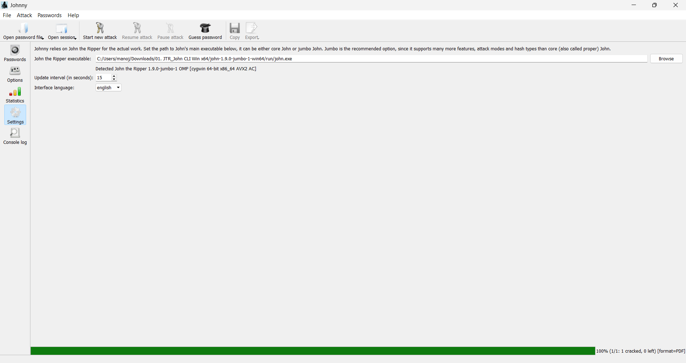
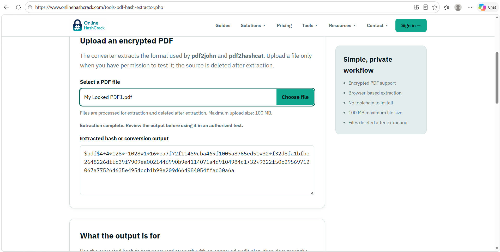
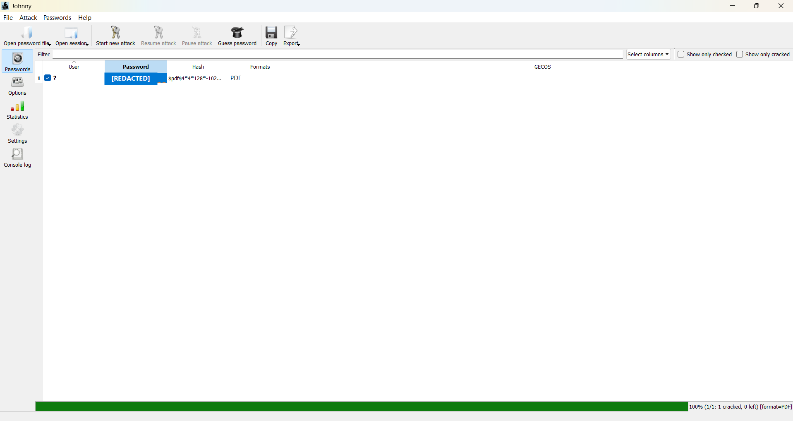
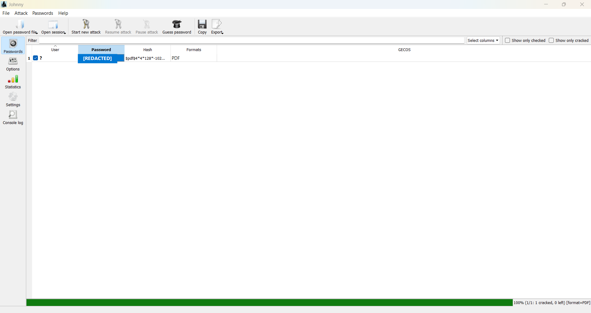

# Module 1: Password Auditing with John the Ripper (Johnny GUI)

## Executive Summary
This module documents the offline password recovery and cryptographic auditing practicals completed using **John the Ripper (JTR) Jumbo v1.9.0** coupled with the **Johnny GUI v2.2** interface on a native **Windows 11** workstation. 

The primary objective was auditing the resistance of standard password-protected documents against automated offline dictionary attacks, analyzing cryptographic key derivation weaknesses, and evaluating password complexity standards.

---

## Technical Architecture & Setup

### Component Breakdown
* **Core Engine:** John the Ripper v1.9.0 Jumbo 1 (64-bit Windows build with OpenMP multi-threading and AVX2 CPU acceleration).
* **Graphical Frontend:** Johnny GUI v2.2 (Cross-platform Qt-based GUI designed to manage JTR sessions, attack parameters, and hash lists).
* **Target Artifacts:** Three encrypted PDF documents (`My Locked PDF1.pdf`, `My Locked PDF2.pdf`, `My Locked PDF3.pdf`).
* **Execution Paradigm:** Pure offline execution. No cryptographic hashes or file payloads were transmitted over external networks during the cracking phase.

### Configuration Workflow
1. **Johnny Executable Linking:**  
   Johnny requires a direct path pointer to the compiled `john.exe` binary. Within the Johnny interface under the **Settings** tab, the executable path was configured to:
   ```text
   C:/Users/manoj/Downloads/01. JTR_John CLI Win x64/john-1.9.0-jumbo-1-win64/run/john.exe
   ```
   Johnny successfully recognized the underlying engine as `John the Ripper 1.9.0-jumbo-1 OMP [cygwin 64-bit x86_64 AVX2 AC]`.


*Figure M1-1: Johnny GUI configuration linking to the native John the Ripper binary.*

---

## Hash Extraction Methodology

Prior to executing offline dictionary attacks in JTR, cryptographic metadata must be extracted from the target document into a format compatible with John the Ripper's `$pdf$` parser.

1. **Extraction Process:**  
   Using a PDF hash parser, the security handler dictionary from `My Locked PDF1.pdf` was parsed, extracting the cipher parameters, salt, user password validation string (`U`), and owner password string (`O`).
2. **Format Structure:**
   ```text
   $pdf$4*4*128*-1028*1*16*[Salt]*32*[U-String]*32*[O-String]
   ```
   * `$pdf$`: JTR format signature.
   * `4*4`: PDF specification version and Revision 4 security handler.
   * `128`: 128-bit symmetric encryption key length.
   * `-1028`: Permissions bitmask integer.
   * `1*16`: Metadata encryption flag and 16-byte document salt.
   * `32`: 32-byte validation string lengths for authentication verification.


*Figure M1-2: Cryptographic hash extraction from the encrypted PDF container.*

---

## Practical Auditing & Recovery Results

Each target hash was imported into Johnny via **Open password file**, followed by initiating an automated attack (**Start new attack**).

### 1. Target PDF 1
* **Input Target:** Extracted hash from `My Locked PDF1.pdf`.
* **Execution Status:** 100% completed (1/1 cracked).
* **Observed Vulnerability:** Password comprised of standard dictionary words with hyphenation. Easily resolved through basic dictionary wordlist matching.
* **Security Redaction:** Plaintext credential masked under responsible disclosure guidelines (`[REDACTED]`).


*Figure M1-3: Successful password recovery for Target 1 in Johnny GUI.*

### 2. Target PDF 2
* **Input Target:** Extracted hash from `My Locked PDF2.pdf`.
* **Execution Status:** 100% completed (1/1 cracked).
* **Observed Vulnerability:** Highly predictable baseline password with standard capitalization and trailing single-digit numeric appendage. Matches global top-10 common password dictionaries instantly.
* **Security Redaction:** Plaintext credential masked (`[REDACTED]`).


*Figure M1-4: Successful password recovery for Target 2 in Johnny GUI.*

### 3. Target PDF 3
* **Input Target:** Extracted hash from `My Locked PDF3.pdf`.
* **Execution Status:** 100% completed (1/1 cracked).
* **Observed Vulnerability:** Keyboard walking sequence across adjacent vertical physical keys. While alphanumeric, spatial key adjacency rules recover such patterns rapidly.
* **Security Redaction:** Plaintext credential masked (`[REDACTED]`).


*Figure M1-5: Successful password recovery for Target 3 in Johnny GUI.*

---

## Key Learnings & Technical Observations

1. **Native Compute Advantage:** The 64-bit multi-threaded AVX2 build leverages CPU SIMD vector extensions, computing candidate hash evaluations at maximum host speed without virtual machine overhead.
2. **Session Persistence:** Johnny maintains session state, allowing interrupted password auditing sessions to resume without reprocessing earlier dictionary entries.
3. **Format Sensitivity:** Prefix artifacts (such as Python byte notation `b'...'`) must be removed during preprocessing to maintain strict parser conformity with JTR syntax.
