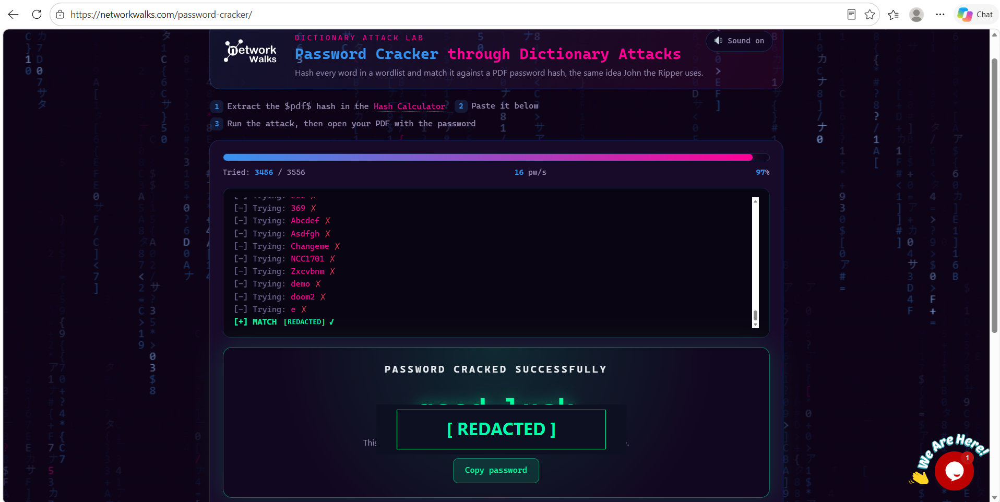
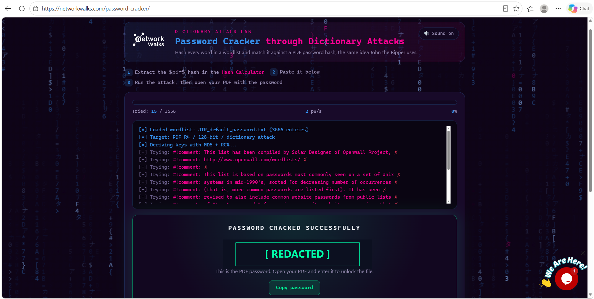
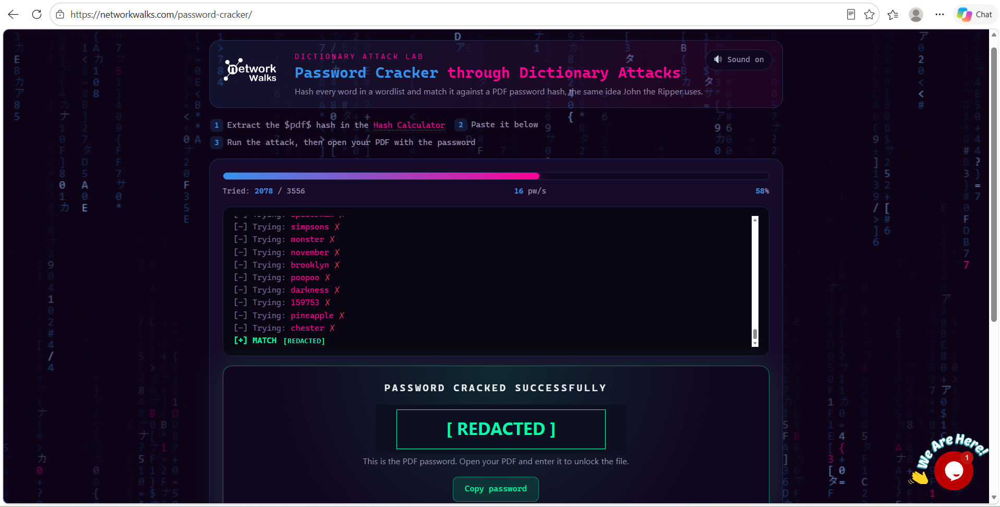

# Module 2: Password Auditing with NetworkWalks Tools

## Executive Summary
This module documents password auditing practicals executed using the **NetworkWalks Security Tool Suite**:
1. **NetworkWalks Hash Calculator** (`https://networkwalks.com/hash-calculator/`)
2. **NetworkWalks Password Cracker** (`https://networkwalks.com/password-cracker/`)

The objective was exploring browser-native cryptographic evaluation tools, performing client-side dictionary attacks against PDF security handlers, and analyzing the performance dynamics between client-side web tools and native binary engines.

---

## Architectural Overview & Operational Mechanics

### 1. NetworkWalks Hash Calculator
* **Functionality:** Extracts cryptographic metadata from password-protected document containers directly inside the client browser.
* **Mechanism:** Reads the binary header and `/Encrypt` catalog of uploaded documents, generating standard `$pdf$...` hash representation for subsequent dictionary auditing.
* **Privacy Model:** File inspection occurs locally within the browser context using client-side JavaScript file parsing APIs without transmitting full document bodies to external servers.

### 2. NetworkWalks Password Cracker
* **Functionality:** Executes client-side dictionary-based attacks against candidate `$pdf$` hashes.
* **Cryptographic Pipeline:**
  * Ingests target hash specification (PDF Revision 4, 128-bit key).
  * Iterates across wordlist candidates.
  * Computes candidate encryption keys utilizing MD5 hashing combined with RC4 / AES stream derivation.
  * Compares derived validation blocks against the document user validation string (`U`).
  * Triggers a positive match upon identical block computation.

### 3. Wordlist Management
* **Built-in Dictionaries:** Standard 100-word common credential lists for rapid testing.
* **Extended Wordlist Loading:** Capability to ingest structured text dictionaries, specifically utilizing `JTR_default_password.txt` containing 3,556 standardized entries.

---

## Practical Execution & Verification

### 1. Target PDF 1 Auditing
* **Tool Interface:** NetworkWalks Password Cracker (Dictionary Mode).
* **Wordlist Parameter:** Standard dictionary iteration.
* **Throughput:** Evaluated at ~16 passwords per second (`16 pw/s`).
* **Progress:** Match achieved at entry 3,456 of 3,556 (97% completion).
* **Finding:** Weak dictionary phrase structure vulnerable to sequential wordlist evaluation.

*Figure M2-1: NetworkWalks Password Cracker completing candidate recovery for Target 1.*

### 2. Target PDF 2 Auditing
* **Tool Interface:** NetworkWalks Password Cracker.
* **Wordlist Parameter:** Loaded custom wordlist `JTR_default_password.txt` (3,556 entries).
* **Target Profile:** PDF R4 / 128-bit key derivation via MD5 + RC4.
* **Finding:** Standard default credential matched rapidly early in the wordlist sequence due to high real-world prevalence.

*Figure M2-2: Custom wordlist processing and successful recovery for Target 2.*

### 3. Target PDF 3 Auditing
* **Tool Interface:** NetworkWalks Password Cracker.
* **Wordlist Parameter:** `JTR_default_password.txt`.
* **Throughput:** Sustained ~16 passwords per second (`16 pw/s`).
* **Progress:** Match achieved at entry 2,078 of 3,556 (58% completion).
* **Finding:** Alphanumeric keyboard pattern cracked via standard dictionary inclusion.

*Figure M2-3: Candidate match confirmation for Target 3 at 58% search space completion.*

---

## Technical Comparison: Web Suite vs. Native Binary

| Dimension | NetworkWalks Web Tools | Native JTR (Johnny GUI) |
|---|---|---|
| **Execution Environment** | Client Browser (JavaScript / Web Crypto) | Native 64-bit Windows Binary (Cygwin/C) |
| **Setup Complexity** | Zero installation; runs instantly | Requires binary path linking and libraries |
| **Throughput & Speed** | ~16 to 25 pw/s (browser single-thread) | Thousands to millions pw/s (OMP / AVX2) |
| **Dictionary Scaling** | Lightweight lists (thousands of lines) | Massive datasets (RockYou with 14M+ entries) |
| **Attack Flexibility** | Dictionary matching | Dictionary, Hybrid, Rule-based, Brute-force |
| **Best Operational Use** | Rapid client-side triage and teaching | In-depth professional offline hash auditing |
