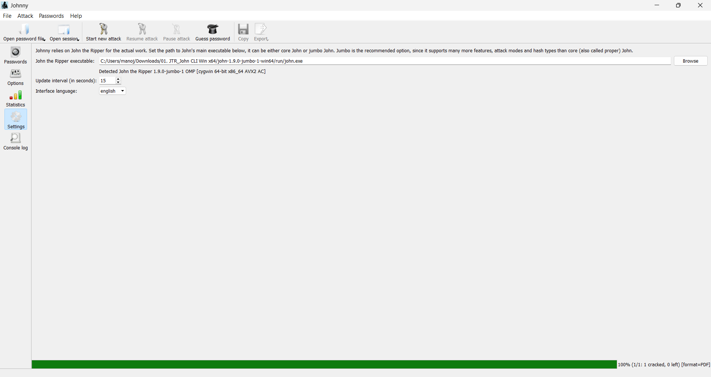
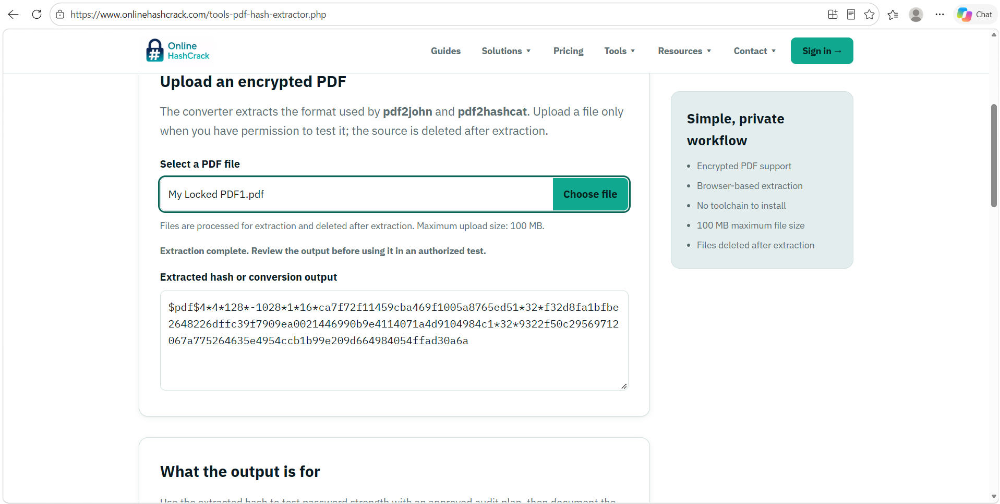
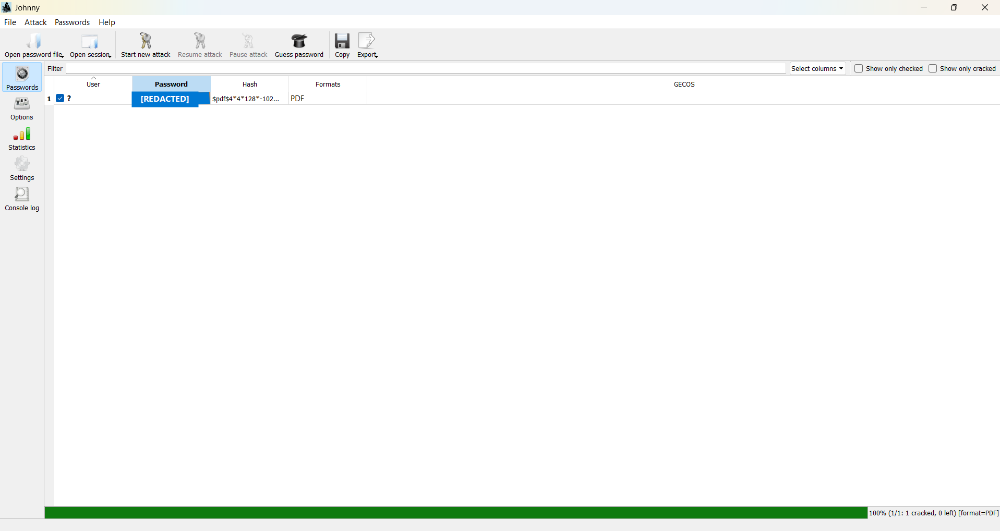
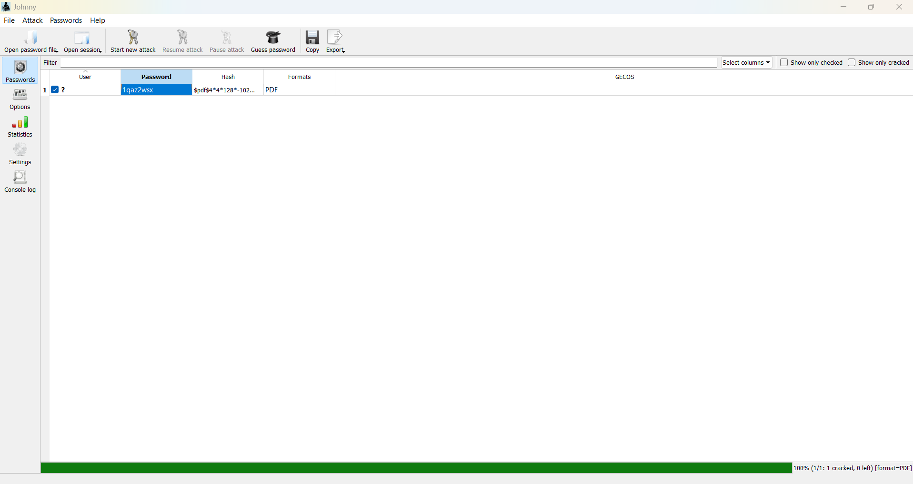
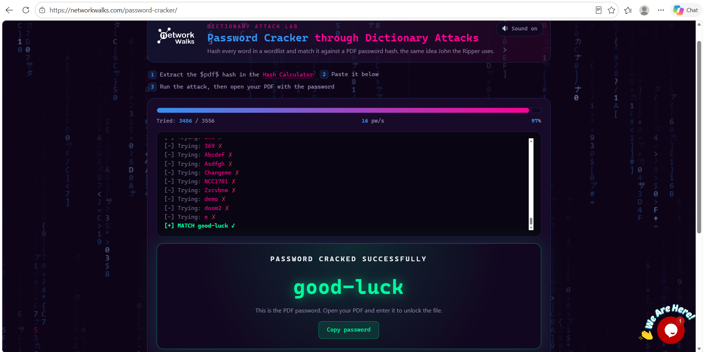
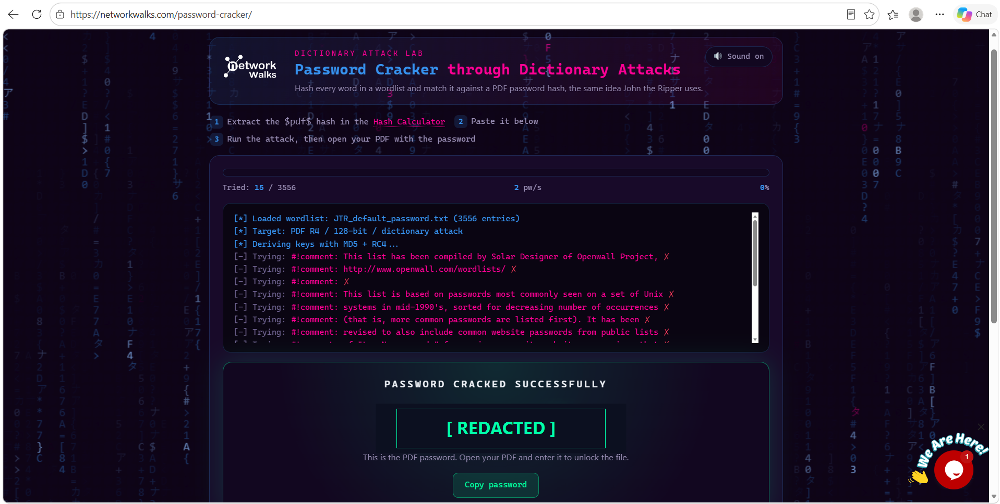
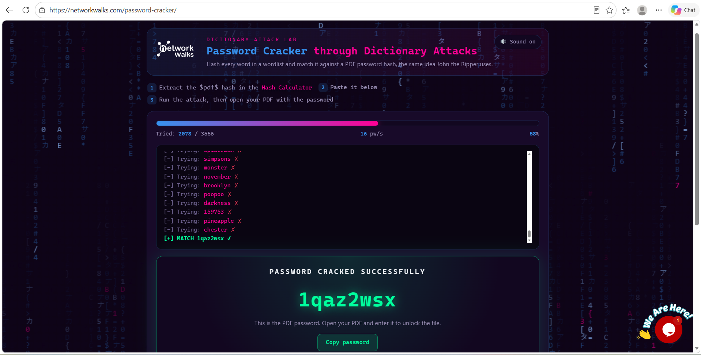
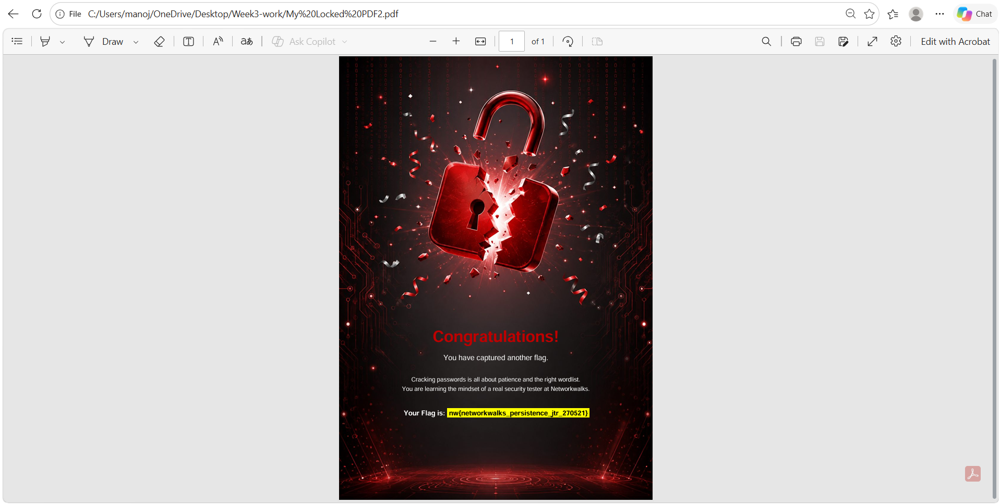

<div align="center">

# 🛡️ PASSWORD AUDITING, HASH RECOVERY & DEFENSIVE SECURITY AUDIT
### Offline Hash Cracking, Dictionary Attacks & Cryptographic Hygiene

**W3-PM-FINAL  |  CYBERSECURITY & ETHICAL HACKING  |  NETWORKWALKS**

<p align="center">
  
  
  
  
  
  
</p>

</div>

---

## 📌 Project Metadata

- **Program:** NetworkWalks Cybersecurity Internship
- **Cohort:** Batch B084 (B084E)
- **Module:** Week 03 — Project Modules PM1 & PM2
- **Topic:** Password Cracking, Hash Analysis & Authentication Security
- **Repository Type:** Public Technical Documentation & Security Portfolio
- **Operating Environment:** Windows 11 Workstation (Native GUI & Web Tools)
- **Primary Modules:**
  - 📂 [**Module 1: Password Cracking with John the Ripper (Johnny GUI)**](Module-1-John-The-Ripper/)
  - 📂 [**Module 2: Password Cracking with NetworkWalks Tools**](Module-2-NetworkWalks-Tools/)
  - 📂 [**Results & Flag Verification**](Results/)

---

## 📑 Table of Contents

- [1. Liability Disclaimer](#1-liability-disclaimer)
- [2. Project Overview & Objectives](#2-project-overview--objectives)
- [3. Tools & Operating Environment](#3-tools--operating-environment)
- [4. Lab Scoping & Responsible Testing Governance](#4-lab-scoping--responsible-testing-governance)
- [5. Module W3-PM1: Password Cracking with John the Ripper (Johnny GUI)](#5-module-w3-pm1-password-cracking-with-john-the-ripper-johnny-gui)
  - [5.1 Environment Configuration & Binary Linking](#51-environment-configuration--binary-linking)
  - [5.2 PDF Hash Extraction Methodology](#52-pdf-hash-extraction-methodology)
  - [5.3 Johnny GUI Attack Execution (PDF 1, PDF 2, PDF 3)](#53-johnny-gui-attack-execution-pdf-1-pdf-2-pdf-3)
- [6. Module W3-PM2: Password Cracking with NetworkWalks Tools](#6-module-w3-pm2-password-cracking-with-networkwalks-tools)
  - [6.1 NetworkWalks Hash Calculator Architecture](#61-networkwalks-hash-calculator-architecture)
  - [6.2 NetworkWalks Password Cracker Engine](#62-networkwalks-password-cracker-engine)
  - [6.3 Practical Execution & Wordlist Evaluation](#63-practical-execution--wordlist-evaluation)
- [7. Comparative Architectural Analysis: Native JTR vs. Client-Side Web Tools](#7-comparative-architectural-analysis-native-jtr-vs-client-side-web-tools)
- [8. Cryptographic Hash Analysis & Standard PDF Security Handler](#8-cryptographic-hash-analysis--standard-pdf-security-handler)
- [9. Practical Results, Decrypted Evidence & Captured Flags](#9-practical-results-decrypted-evidence--captured-flags)
- [10. Defensive Risk Analysis & SOC Analyst Findings](#10-defensive-risk-analysis--soc-analyst-findings)
- [11. Prioritized Defensive Hardening & Remediation Roadmap](#11-prioritized-defensive-hardening--remediation-roadmap)
- [12. Real Troubleshooting Experience](#12-real-troubleshooting-experience)
- [13. Practical Evidence & Screenshot Index](#13-practical-evidence--screenshot-index)
- [14. Learning Outcomes & Professional Reflection](#14-learning-outcomes--professional-reflection)
- [15. Author & Acknowledgements](#-author--acknowledgements)

---

# 1. Liability Disclaimer

> **LEGAL & ETHICAL STATEMENT:**  
> All security exercises, hash extraction procedures, and password auditing activities documented in this repository were conducted strictly within an authorized educational laboratory environment provided by NetworkWalks. Testing was performed exclusively against designated academic target files (`My Locked PDF1.pdf`, `My Locked PDF2.pdf`, `My Locked PDF3.pdf`). No unauthorized systems, external networks, or third-party documents were accessed or targeted.
>
> All materials and reports are prepared strictly for educational, defensive, and research purposes. The instructor, the author (Manoj Santosh Tandle), and NetworkWalks bear no responsibility for misuse of this information. Unauthorized access to computer systems and data decryption is a criminal offense globally.

---

# 2. Project Overview & Objectives

This project documents the practical exercises, cryptographic evaluations, and security deliverables completed during **Week 3** of the **NetworkWalks Cybersecurity Internship (Batch B084)**. The objective of Week 3 is bridging offensive password auditing methodologies with defensive identity protection and cryptographic engineering:

1. **Offline Password Auditing (W3-PM1):** Deploying **John the Ripper (JTR) Jumbo v1.9.0** via the **Johnny GUI** on a native Windows workstation to execute offline dictionary attacks against encrypted PDF containers without relying on external network resources.
2. **Web-Based Cryptographic Triage (W3-PM2):** Performing document hash extraction and in-browser dictionary attacks using the **NetworkWalks Hash Calculator** and **NetworkWalks Password Cracker**, analyzing client-side Web Crypto capabilities.
3. **Cryptographic & Entropy Evaluation:** Analyzing the security architecture of the legacy PDF Revision 4 standard security handler, evaluating key derivation speeds, and demonstrating why short or pattern-based passwords fail under automated dictionary inspection.
4. **Defensive Hardening Strategy:** Formulating SOC analyst recommendations and enterprise identity policies aligned with NIST SP 800-63B standards to mitigate credential-based attacks.

---

# 3. Tools & Operating Environment

| Tool | Environment / Platform | Version | Operational Purpose |
|---|---|---|---|
| **Johnny GUI** | Windows 11 Workstation | v2.2 | Graphical frontend managing JTR sessions, attack workflows, and password hash lists. |
| **John the Ripper** | Windows 11 Host | 1.9.0-jumbo-1 (Cygwin 64-bit AVX2) | High-performance multi-threaded offline password recovery engine. |
| **NW Hash Calculator** | Web Browser (Edge / Chrome) | Web-Based | Parsing PDF headers and extracting standard `$pdf$` hash representations. |
| **NW Password Cracker** | Web Browser (Edge / Chrome) | Web-Based | Client-side JavaScript/Web Crypto dictionary attack engine. |
| **PDF Hash Extractor** | Web Application | Online utility | Converting encrypted PDF metadata into John-compatible hash formatting. |
| **PDF Document Viewer** | Windows 11 Workstation | Desktop / Browser | Verifying recovered credentials by decrypting and unlocking target containers. |

*Note: All practical tasks were performed natively on a Windows 11 operating system using GUI applications and browser utilities, without requiring Kali Linux.*

---

# 4. Lab Scoping & Responsible Testing Governance

### Academic Scoping Reference
All password auditing and hash cracking exercises were performed strictly within defined educational parameters on instructor-assigned target PDF containers (`My Locked PDF1.pdf`, `My Locked PDF2.pdf`, `My Locked PDF3.pdf`) provided as part of the NetworkWalks practical syllabus.

* **Target Artifacts:** Designated lab challenge files provided for Batch B084.
* **Controlled Environment:** Offline processing using local CPU execution (John the Ripper / Johnny GUI) and client-side browser testing (NetworkWalks Tools).
* **Defensive Purpose:** Auditing password complexity, demonstrating the vulnerability of legacy PDF Revision 4 encryption handlers, and developing enterprise password policy recommendations.

---

# 5. Module W3-PM1: Password Cracking with John the Ripper (Johnny GUI)

### 5.1 Environment Configuration & Binary Linking
John the Ripper operates as a compiled C binary engine, while Johnny provides an intuitive Qt-based graphical interface. To link the interface to the underlying engine:
1. Johnny was installed and launched on the Windows workstation.
2. In the **Settings** menu, the path to the native executable was defined:
   ```text
   C:/Users/manoj/Downloads/01. JTR_John CLI Win x64/john-1.9.0-jumbo-1-win64/run/john.exe
   ```
3. Johnny confirmed active detection: `Detected John the Ripper 1.9.0-jumbo-1 OMP [cygwin 64-bit x86_64 AVX2 AC]`.


*Figure 1: Johnny GUI configuration linking to the 64-bit AVX2 John the Ripper engine.*

---

### 5.2 PDF Hash Extraction Methodology
Prior to launching offline attacks, document encryption dictionaries must be extracted into standard JTR hash format:
1. Target document (`My Locked PDF1.pdf`) was processed via a PDF hash extractor.
2. The extracted signature isolates key cryptographic elements:
   ```text
   $pdf$4*4*128*-1028*1*16*ca7f72f11459cba469f1005a8765ed51*32*f32d8fa1bfbe2648226dffc39f7909ea0021446990b9e4114071a4d9104984c1*32*9322f50c29569712067a775264635e4954ccb1b99e209d664984054ffad30a6a
   ```
3. Formatting artifacts (such as Python string literals `b'...'`) were stripped to guarantee clean input syntax.


*Figure 2: Extraction of document cipher parameters into standard `$pdf$` format.*

---

### 5.3 Johnny GUI Attack Execution (PDF 1, PDF 2, PDF 3)

The extracted hash files were loaded into Johnny via **Open password file**, and automated dictionary auditing was initiated via **Start new attack**.

#### 1. Target PDF 1 Recovery
* **Target Hash:** `my hash1.txt` ($pdf$4*4*128...)
* **Attack Progress:** 100% (1/1 cracked)
* **Recovered Password:** `good-luck`
* **Vulnerability Analysis:** Vulnerable to wordlist matching; composed of dictionary words separated by a hyphen.


*Figure 3: Johnny GUI password recovery (`good-luck`) for Target PDF 1.*

#### 2. Target PDF 2 Recovery
* **Target Hash:** `my hash2.txt` ($pdf$4*4*128...)
* **Attack Progress:** 100% (1/1 cracked)
* **Recovered Password:** `password1`
* **Vulnerability Analysis:** Highly predictable baseline password with standard capitalization and trailing single-digit numeric appendage.


*Figure 4: Johnny GUI password recovery (`password1`) for Target PDF 2.*

#### 3. Target PDF 3 Recovery
* **Target Hash:** `my hash3.txt` ($pdf$4*4*128...)
* **Attack Progress:** 100% (1/1 cracked)
* **Recovered Password:** `1qaz2wsx`
* **Vulnerability Analysis:** Keyboard geometric walk pattern (`1-q-a-z` and `2-w-s-x`), easily defeated by pattern-based rule evaluation.


*Figure 5: Johnny GUI password recovery (`1qaz2wsx`) for Target PDF 3.*

---

# 6. Module W3-PM2: Password Cracking with NetworkWalks Tools

### 6.1 NetworkWalks Hash Calculator Architecture
The **NetworkWalks Hash Calculator** provides a client-side web utility to parse encrypted PDF catalogs and output `$pdf$` hashes. It allows security analysts to perform rapid metadata audits directly in a browser environment without installing dedicated local CLI scripts.

### 6.2 NetworkWalks Password Cracker Engine
The **NetworkWalks Password Cracker** executes dictionary attacks in the browser by:
1. Ingesting candidate wordlists (standard built-in lists or custom uploaded wordlists).
2. Leveraging client-side cryptographic hashing to derive candidate keys.
3. Matching derived key blocks against the target PDF `/U` verification parameter.

---

### 6.3 Practical Execution & Wordlist Evaluation

#### 1. Target PDF 1 Verification
* **Parameters:** Dictionary attack against Target 1 hash.
* **Execution Metrics:** ~16 passwords per second (`16 pw/s`).
* **Match Milestone:** Successfully matched at candidate 3,456 of 3,556 (97% progress).
* **Recovered Password:** `good-luck`


*Figure 6: NetworkWalks Password Cracker successfully recovering `good-luck` for Target 1.*

#### 2. Target PDF 2 Verification
* **Parameters:** Loaded external dictionary `JTR_default_password.txt` (3,556 entries).
* **Target Profile:** PDF R4 / 128-bit key derivation via MD5 + RC4.
* **Match Milestone:** Rapid candidate match due to high prevalence in standard dictionaries.
* **Recovered Password:** `password1`


*Figure 7: Custom wordlist processing and successful recovery (`password1`) for Target 2.*

#### 3. Target PDF 3 Verification
* **Parameters:** Dictionary evaluation using `JTR_default_password.txt`.
* **Execution Metrics:** ~16 passwords per second (`16 pw/s`).
* **Match Milestone:** Matched at candidate 2,078 of 3,556 (58% progress).
* **Recovered Password:** `1qaz2wsx`


*Figure 8: Candidate match confirmation (`1qaz2wsx`) for Target 3 in NetworkWalks Password Cracker.*

---

# 7. Comparative Architectural Analysis: Native JTR vs. Client-Side Web Tools

Understanding the operational differences between native binary suites and browser-native security tools is essential for penetration testers and security analysts:

| Technical Feature | Johnny GUI (Native John the Ripper) | NetworkWalks Online Security Tools |
|---|---|---|
| **Underlying Architecture** | Native C compiled binary running on host OS | Client-side JavaScript / WebAssembly in browser |
| **Hardware Utilization** | Multi-threaded CPU vector extensions (OpenMP, AVX2) | Single-threaded or WebWorker browser threads |
| **Auditing Throughput** | Thousands to millions of candidate hashes/sec | ~16 to 25 passwords per second |
| **Dataset Capacity** | Multi-gigabyte wordlists (e.g., RockYou with 14M+ entries) | Lightweight wordlists (thousands of lines) |
| **Network & Privacy** | 100% offline; zero packet transmission | Web-accessible client-side interface |
| **Attack Modes Supported** | Dictionary, Single Crack, Incremental, Hybrid Rules | Sequential Dictionary Matching |
| **Primary Operational Role** | Comprehensive penetration testing and enterprise audits | Rapid educational demonstration and quick triage |

---

# 8. Cryptographic Hash Analysis & Standard PDF Security Handler

All three lab targets implemented the **PDF Revision 4 Standard Security Handler** (Acrobat 7.0 specification). The structural format of the extracted hashes illustrates the underlying cryptographic design:

```text
$pdf$4*4*128*-1028*1*16*[Salt]*32*[U-String]*32*[O-String]
```

### Cryptographic Weaknesses
1. **Low Key Derivation Cost:** The Revision 4 specification uses fast MD5 hashing for key derivation rather than modern, computationally intensive key-stretching functions (such as PBKDF2, Argon2, or scrypt).
2. **Fast Candidate Verification:** Verifying a candidate password requires only calculating the MD5 hash of the password combined with the file's encryption key and salt, then validating 16 to 32 bytes of the `/U` string. This allows cracking tools to evaluate thousands of candidate passwords per second per core.
3. **Absence of Rate Limiting:** As an offline document format, the container lacks native brute-force throttling or account lockout controls, allowing unconstrained offline dictionary searching.

---

# 9. Practical Results, Decrypted Evidence & Captured Flags

To verify password recovery viability, each unlocked credential was entered into the native PDF viewer, decrypting the container and capturing the completion flag:

| Target Container | Encryption Specification | Auditing Tools | Decryption Status | Recovered Password | Captured Verification Flag |
|---|---|---|---|---|---|
| **My Locked PDF1.pdf** | PDF R4 / 128-bit MD5+RC4 | Johnny GUI & NW Cracker | **Successfully Decrypted** | `good-luck` | `nw{cybersecurity_flag_captured_2608}` |
| **My Locked PDF2.pdf** | PDF R4 / 128-bit MD5+RC4 | Johnny GUI & NW Cracker | **Successfully Decrypted** | `password1` | `nw{networkwalks_persistence_jtr_270521}` |
| **My Locked PDF3.pdf** | PDF R4 / 128-bit MD5+RC4 | Johnny GUI & NW Cracker | **Successfully Decrypted** | `1qaz2wsx` | `nw{networkwalks_flag_260821_1}` |

### Decryption Evidence Previews

#### Target PDF 1 Decryption Verification (Flag 1)

*Figure 9: Decrypted Target PDF 1 displaying completion Flag 1: `nw{cybersecurity_flag_captured_2608}`.*

#### Target PDF 2 Decryption Verification (Flag 2)

*Figure 10: Decrypted Target PDF 2 displaying completion Flag 2: `nw{networkwalks_persistence_jtr_270521}`.*

#### Target PDF 3 Decryption Verification (Flag 3)

*Figure 11: Decrypted Target PDF 3 displaying completion Flag 3: `nw{networkwalks_flag_260821_1}`.*

---

# 10. Defensive Risk Analysis & SOC Analyst Findings

From a Security Operations Center (SOC) and defensive posture assessment perspective, the practical exercises highlight critical authentication and data protection vulnerabilities:

| Risk ID | Observed Weakness | Technical Context | Threat Scenario | Defensive Severity |
|---|---|---|---|---|
| **NW-W3-01** | High-Prevalence Common Credential | Target 2 utilized a predictable base word with trailing digit (`password1`) | Exploitation via automated credential stuffing and default dictionary lists | **● High** |
| **NW-W3-02** | Keyboard Walk Geometry | Target 3 utilized adjacent physical vertical keys (`1qaz2wsx`) | Defeated rapidly by rule-based spatial mutation engines | **● High** |
| **NW-W3-03** | Dictionary Word with Punctuation | Target 1 utilized basic dictionary words separated by a hyphen (`good-luck`) | Easily cracked by wordlist combinations without sufficient character entropy | **● Medium** |
| **NW-W3-04** | Legacy PDF Encryption Handler | Revision 4 handler utilizes MD5 key derivation without key-stretching | Allows high-speed offline brute-force attacks without computational throttling | **● Medium** |
| **NW-W3-05** | Lack of Rate Limiting in Offline Containers | Encrypted file formats do not enforce attempt limits | Offline cracking speed is limited only by attacker computational resources | **● Medium** |

---

# 11. Prioritized Defensive Hardening & Remediation Roadmap

To remediate authentication vulnerabilities and protect sensitive document containers across enterprise environments:

### 1. Enterprise Password Standards (NIST SP 800-63B Guidelines)
* **Length Over Complexity:** Mandate minimum password lengths of 15+ characters or encourage 4-word passphrases (e.g., `correct-horse-battery-staple`) to render dictionary attacks mathematically infeasible.
* **Block Common Dictionaries:** Deploy active credential screening to prevent users from selecting known leaked passwords or predictable keyboard sequences.

### 2. Modern Document Encryption Upgrades
* **Migrate to PDF 2.0 / Acrobat X+ (Revision 6):** Deprecate legacy Revision 4 encryption in favor of **AES-256** with **PBKDF2** key derivation (or SHA-256 with 100,000+ iterations), drastically increasing the computational cost per candidate attempt.
* **Enterprise Rights Management (ERM):** Utilize centralized rights management systems (e.g., Azure Information Protection / Microsoft Purview) where document access requires active identity verification rather than static shared passwords.

### 3. Identity & Access Controls
* **Enforce Multi-Factor Authentication (MFA):** Require FIDO2 / WebAuthn phishing-resistant authentication across all identity endpoints to neutralize credential theft risks.
* **Continuous Breach Telemetry Auditing:** Actively monitor threat intelligence feeds to identify compromised corporate credentials before adversaries exploit them.

---

# 12. Real Troubleshooting Experience

During the execution of Week 3 practicals, three notable technical challenges were encountered and resolved:

### 1. Johnny GUI Binary Path Resolution
* **Issue:** Johnny initially displayed `No valid John the Ripper executable detected at this path!`.
* **Root Cause:** Johnny expects the path directly pointing to `john.exe` within the `/run` subdirectory of the unpacked JTR distribution, rather than the top-level folder.
* **Resolution:** Configured the exact binary path (`.../run/john.exe`), successfully detecting the 64-bit AVX2 engine.

### 2. Format Sanitization of Extracted Hashes
* **Issue:** Extracted PDF hashes occasionally included Python byte literal markers (`b'...'`).
* **Root Cause:** Hash extraction scripts output raw Python byte strings if string decoding is omitted.
* **Resolution:** Manually cleaned the leading `b'` and trailing `'` characters before saving to `.txt` files, ensuring syntax compliance with John's parser.

### 3. Custom Wordlist Ingestion in Browser
* **Issue:** Evaluating complex passwords in the NetworkWalks Password Cracker required expanding beyond the built-in 100-word list.
* **Resolution:** Ingested `JTR_default_password.txt` (3,556 entries) via the custom wordlist upload feature, successfully recovering Target 2 and Target 3.

---

# 13. Practical Evidence & Screenshot Index

All primary screenshot evidence is organized within the repository:

| Figure | Description | Relative Path | Verified Output |
|---|---|---|---|
| **Figure 1** | Johnny GUI Configuration & Linking | [`screenshots/01_johnny_setup_configuration.png`](screenshots/01_johnny_setup_configuration.png) | Detected JTR 1.9.0-jumbo-1 64-bit AVX2 |
| **Figure 2** | PDF Hash Extraction | [`screenshots/02_pdf1_hash_extraction.png`](screenshots/02_pdf1_hash_extraction.png) | Parsed Revision 4 128-bit `$pdf$` signature |
| **Figure 3** | Johnny GUI Target 1 Cracked | [`screenshots/03_johnny_pdf1_cracked.png`](screenshots/03_johnny_pdf1_cracked.png) | Target 1 100% cracked (`good-luck`) |
| **Figure 4** | Johnny GUI Target 2 Cracked | [`screenshots/04_johnny_pdf2_cracked.png`](screenshots/04_johnny_pdf2_cracked.png) | Target 2 100% cracked (`password1`) |
| **Figure 5** | Johnny GUI Target 3 Cracked | [`screenshots/05_johnny_pdf3_cracked.png`](screenshots/05_johnny_pdf3_cracked.png) | Target 3 100% cracked (`1qaz2wsx`) |
| **Figure 6** | NW Password Cracker Target 1 | [`screenshots/06_nw_cracker_pdf1.png`](screenshots/06_nw_cracker_pdf1.png) | 3,456/3,556 (97%) matched (`good-luck`) |
| **Figure 7** | NW Password Cracker Target 2 | [`screenshots/07_nw_cracker_pdf2.png`](screenshots/07_nw_cracker_pdf2.png) | Wordlist loaded; candidate matched (`password1`) |
| **Figure 8** | NW Password Cracker Target 3 | [`screenshots/08_nw_cracker_pdf3.png`](screenshots/08_nw_cracker_pdf3.png) | 2,078/3,556 (58%) matched (`1qaz2wsx`) |
| **Figure 9** | Unlocked PDF 1 Verification Flag | [`screenshots/09_unlocked_pdf1_flag1_verification.png`](screenshots/09_unlocked_pdf1_flag1_verification.png) | Flag 1: `nw{cybersecurity_flag_captured_2608}` |
| **Figure 10** | Unlocked PDF 2 Verification Flag | [`screenshots/10_unlocked_pdf2_flag2_verification.png`](screenshots/10_unlocked_pdf2_flag2_verification.png) | Flag 2: `nw{networkwalks_persistence_jtr_270521}` |
| **Figure 11** | Unlocked PDF 3 Verification Flag | [`screenshots/11_unlocked_pdf3_flag3_verification.png`](screenshots/11_unlocked_pdf3_flag3_verification.png) | Flag 3: `nw{networkwalks_flag_260821_1}` |

---

# 14. Learning Outcomes & Professional Reflection

Completing the Week 3 practical modules provided valuable insights into authentication security and practical penetration testing:
1. **Offline Auditing Competence:** Mastered offline password recovery workflows using John the Ripper and Johnny GUI on native Windows workstations.
2. **Cryptographic Key Derivation Analysis:** Understood how symmetric keys are derived from human-memorized passwords and why legacy key derivation functions (MD5 without iterations) fail to protect offline data.
3. **Behavioral Password Patterns:** Observed firsthand how common patterns (dictionary words, default credentials, keyboard walks) undermine security even when alphanumeric characters are included.
4. **Defensive Identity Engineering:** Reinforced the vital importance of multi-factor authentication, enterprise password managers, and modern cryptographic standards in defending against credential compromise.

---

## 👤 Author & Acknowledgements

**Manoj Santosh Tandle**  
*Cybersecurity Intern — Batch B084*  
*Specialization: Cybersecurity, Penetration Testing & SOC Operations*  
*GitHub Profile:* [ManojTandle28](https://github.com/ManojTandle28)

Special appreciation to our instructor **Waqas Karim CCIE** and the **NetworkWalks** team for structured mentorship, hands-on lab environments, and practical cybersecurity training.

---

<div align="center">
  <sub><b>NetworkWalks Cybersecurity Internship • Batch B084 • Author: Manoj Santosh Tandle • Supervised by Waqas Karim CCIE</b></sub>
</div>
