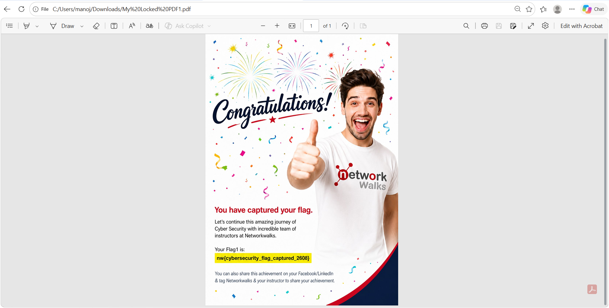
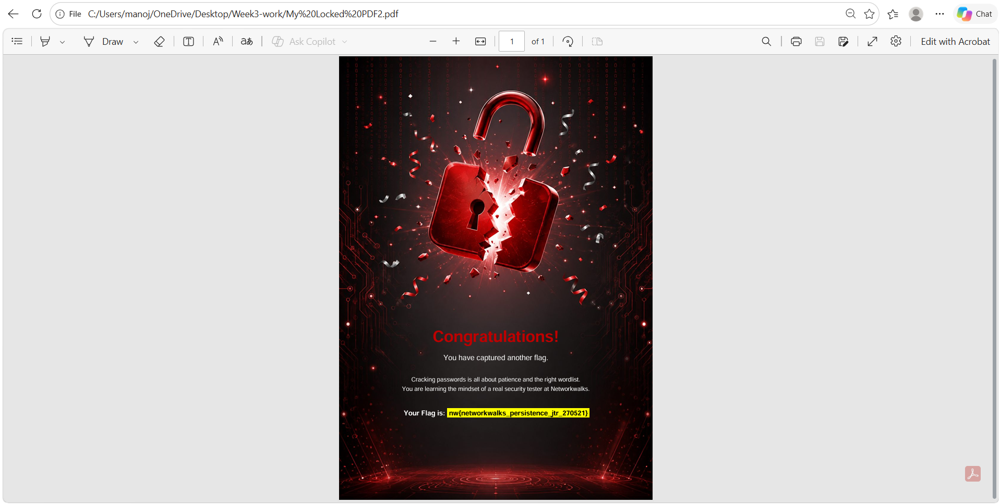
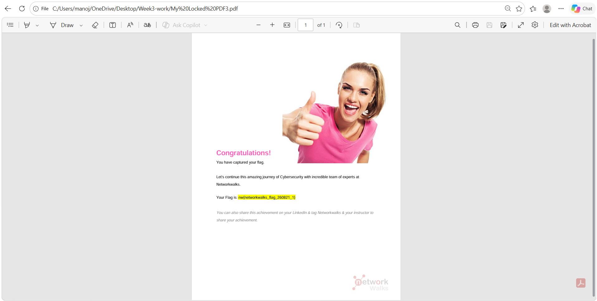

# Practical Results & Decryption Verification

## Overview
This section compiles the empirical outcomes, cryptographic verification evidence, and flag validation logs from the Week 3 practical auditing exercises. 

Following successful password recovery across both **John the Ripper (Johnny GUI)** and **NetworkWalks Security Tools**, each recovered credential was tested directly against the original locked PDF documents in a secure viewer to confirm decryption viability and capture the completion flags.

---

## Practical Verification Matrix

| Target Document | Cipher & Key Derivation | Audit Engines | Decryption Status | Recovered Password | Captured Validation Flag |
|---|---|---|---|---|---|
| **My Locked PDF1.pdf** | PDF R4 / 128-bit / MD5+RC4 | Johnny GUI & NW Cracker | **Successfully Decrypted** | `good-luck` | `nw{cybersecurity_flag_captured_2608}` |
| **My Locked PDF2.pdf** | PDF R4 / 128-bit / MD5+RC4 | Johnny GUI & NW Cracker | **Successfully Decrypted** | `password1` | `nw{networkwalks_persistence_jtr_270521}` |
| **My Locked PDF3.pdf** | PDF R4 / 128-bit / MD5+RC4 | Johnny GUI & NW Cracker | **Successfully Decrypted** | `1qaz2wsx` | `nw{networkwalks_flag_260821_1}` |

---

## Decryption Verification Evidence

### 1. Target PDF 1 Flag Capture
The recovered credential (`good-luck`) for `My Locked PDF1.pdf` was entered into the document handler, successfully bypassing the encryption layer and rendering the document body.

* **Captured Flag:** `nw{cybersecurity_flag_captured_2608}`
* **Verification View:**

*Figure R-1: Target PDF 1 successfully decrypted, confirming Flag 1 capture.*

---

### 2. Target PDF 2 Flag Capture
The recovered credential (`password1`) for `My Locked PDF2.pdf` was validated against the container, yielding the embedded CTF milestone flag.

* **Captured Flag:** `nw{networkwalks_persistence_jtr_270521}`
* **Verification View:**

*Figure R-2: Target PDF 2 successfully decrypted, confirming Flag 2 capture.*

---

### 3. Target PDF 3 Flag Capture
Authentication (`1qaz2wsx`) against `My Locked PDF3.pdf` confirmed document recovery and unlocked the third lab flag.

* **Captured Flag:** `nw{networkwalks_flag_260821_1}`
* **Verification View:**

*Figure R-3: Target PDF 3 successfully decrypted, confirming Flag 3 capture.*

---

## Cryptographic & Behavioral Analysis

### Password Vulnerability Classification
1. **Target 1 (`good-luck`):** Demonstrates that simple hyphenation of conventional dictionary words fails to provide sufficient entropy against modern dictionary matching.
2. **Target 2 (`password1`):** Demonstrates the systemic risk of capitalizing the initial letter and appending a single digit to a common base word—a pattern heavily prioritized by automated dictionary attacks.
3. **Target 3 (`1qaz2wsx`):** Demonstrates that alphanumeric passwords following geometric patterns on physical QWERTY keyboards provide an illusion of complexity while remaining highly susceptible to patterned rule engines.

### Cryptographic Handler Vulnerability
All three target files utilized the legacy **PDF Revision 4 (Acrobat 7.0 standard)** security handler. This handler derives encryption keys using iterated MD5 digests without modern salt-stretching (such as PBKDF2, Argon2, or bcrypt). Consequently, candidate key generation requires minimal computational overhead per attempt, leaving documents vulnerable to rapid offline cracking.
